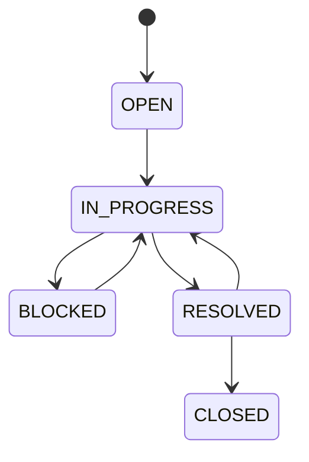
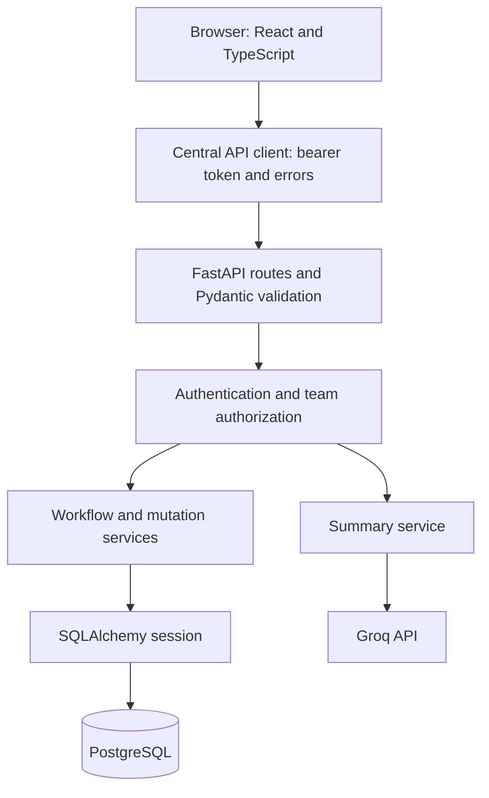

# Relay interview guide

This guide explains the implementation currently in this repository. Example interview answers are suggested wording: adapt them to work you actually did and can demonstrate. Keep implemented behavior, reasons for choosing it, and future improvements separate.

## 1. The project in one minute

> Relay is a full-stack operational work management application. It helps teams track issues, ownership, deadlines, next actions, and approvals in one place. I used a React and TypeScript frontend, a FastAPI backend, and PostgreSQL. The backend applies role permissions within team membership boundaries. It also prevents concurrent users from silently overwriting each other's work and supports safe retries when creating issues. Users can comment, keep private bookmarks, and request an optional Groq summary. The summary is a 100–150-word plain paragraph, and AI never changes issue state or approves anything. The current implementation is an MVP, with clear next steps around account lifecycle, observability, and production hardening.

Be ready to explain every technical phrase in that answer. Sections below provide the details.

## 2. What business problem does it solve?

A task list alone does not answer all operational questions:

- Who owns the issue?
- What should happen next?
- Is it blocked or overdue?
- Is a decision waiting on another person?
- Who changed it and when?
- Can this person access or approve this team's work?

Relay combines structured issues, ownership, a lifecycle, attention rules, discussion, and approvals. The Attention page prioritizes work needing action; All Work is the general directory.

An illustrative use case is a payment reconciliation mismatch. An engineer investigates it, a team lead assigns ownership, a finance colleague decides an approval request, and the team records progress and closes the issue. Approval and issue status are separate workflows.

## 3. The complete user workflow

1. An operator starts PostgreSQL and the API and applies migrations. In development, an explicit seed creates roles, permissions, an example team, and the first administrator.
2. The administrator signs in and creates employee accounts through Users. Creation includes a role grant and, when a team is supplied, membership.
3. An employee signs in. The frontend loads their identity, global permissions, and effective permissions for active teams.
4. A permitted user creates an issue with a title, team, type, and optional description, priority, due date, and parent.
5. An eligible user assigns an owner. Contributors and reviewers can also be assigned.
6. The team moves the issue through valid states, updates the next action, and adds comments.
7. When a decision is needed, an eligible requester creates an approval request with a type and reason.
8. A different eligible teammate approves or rejects the pending request. A designated approver can be specified through the API, although the current frontend form does not select one.
9. Users can bookmark the issue privately or request a short AI summary to catch up.
10. The issue is resolved and then closed through explicit status transitions by permitted users.

The normal lifecycle is:



`CLOSED` has no outgoing transition. Closing requires an additional permission. An approved request does not automatically resolve or close an issue.

## 4. Architecture: what runs where?



### Frontend responsibilities

React renders pages and forms. React Router selects pages. TypeScript describes frontend contracts. TanStack Query manages server data, loading/error states, and cache refreshes. Local React state holds temporary form values and presentation state. The central API client adds authentication, sends JSON, applies timeouts, and converts responses into consistent errors.

### Backend responsibilities

FastAPI exposes HTTP endpoints. Pydantic checks request shapes and constrained values. Dependencies resolve the authenticated user and a database session. Authorization helpers check membership and permission. Services implement shared rules and conditional updates. SQLAlchemy executes queries and transactions against PostgreSQL.

### Infrastructure responsibilities

Compose runs PostgreSQL and the API as separate containers. The frontend runs separately through Vite in development. Database migrations run at Compose API startup. The Dockerfile alone starts Uvicorn and does not automatically migrate. A named volume retains database state.

**Terminology:** this is a modular monolith backend. Its domains have separate files and shared services, but they deploy as one backend process/service with one database. Separate containers for the API and database do not make the backend a microservices architecture.

## 5. Follow one request through the system

Suppose a user clicks a status button to move an issue from OPEN to IN_PROGRESS.

1. `DetailPage.tsx` knows the displayed issue and its version, for example `7`.
2. It invokes the shared issue mutation hook.
3. `api.ts` sends `POST /api/v1/work-items/{id}/transitions` with `{"status":"IN_PROGRESS","version":7}` and a bearer token.
4. FastAPI parses the UUID and Pydantic validates the body.
5. `current_user` verifies the signed token and checks that the account exists and is active.
6. `visible_item` checks read access, active membership, and the transition permission for the issue's team.
7. The route checks the transition against `TRANSITIONS`. A close operation would require `work_item:close` as well.
8. The mutation service updates only the row whose version still equals `7`, increments it to `8`, and updates its timestamp.
9. The route adds a STATUS_CHANGED activity event and commits both operations in one transaction.
10. The response includes the current issue, its new version, assignments, and workflow candidates.
11. The frontend stores the response in its detail cache and invalidates affected issue lists, attention counts, approvals, and activity.

If another user already changed version 7, step 8 matches no row. The service returns `409 stale_version`; the frontend keeps the attempted action, loads the latest version, and requires explicit review and resubmission.

## 6. Authentication versus authorization

**Authentication:** Who are you?

**Authorization:** Can you perform this action on this resource?

### Authentication flow

- Login normalizes the email, looks up the account, checks active status, and verifies its Argon2 password hash.
- The server issues a signed JWT containing user ID (`sub`), issued-at (`iat`), and expiration (`exp`). The default lifetime is 60 minutes.
- The browser stores the token in sessionStorage and sends it in the Authorization header.
- Protected requests verify the signature and required claims, then load the current account from the database.
- A 401 response clears the frontend session and cached user data.

A JWT is signed, not encrypted. Do not put credentials or private business data in it. This implementation keeps permissions in the database rather than freezing them inside the token. Account activation is also checked against the database on requests.

### Team-scoped authorization

For work access, the effective rule is:

```text
active authenticated account
AND active membership in the issue's team
AND the needed global or team-scoped permission
```

Roles group permissions. Membership establishes which team boundary the user belongs to. These are separate concepts and separate tables.

A workspace Admin is powerful but still needs team membership to access that team's issues. User administration specifically requires a global `user:manage` grant; a team-scoped Admin does not qualify.

Lists apply scope in SQL. Detail requests check the same boundary through shared helpers. Inaccessible issues return 404 to avoid disclosing that they exist. Hiding a frontend button is a usability feature, not the security boundary.

### Approval authority

TEAM_LEAD, FINANCE, and MANAGER have approval decision permission in the seeded catalog. ADMIN does not. The requester cannot decide their own request. Any designated approver restriction is enforced separately.

This separates account administration from business decision authority. It is an application rule, not a statement that the application meets a particular compliance certification.

## 7. How each module works

### A. Users and onboarding

**Files:** `app/api/auth.py`, `frontend/src/pages/UsersPage.tsx`, `frontend/src/components/users/CreateUserDialog.tsx`.

The administrator loads backend-provided role options and available teams, enters account details, and creates a user. The backend hashes the password, inserts a user, assigns a role, and optionally creates active membership within one transaction. Duplicate email constraints prevent duplicate accounts. The frontend has a synchronous submission guard and preserves fields when an error needs correction.

New accounts are immediately usable. There is no general public signup, email invitation, account approval phase, or password recovery. Production admins can register using a private deployment signup code; that transaction provisions the catalog, global admin grant, initial team, and membership. The demo intentionally displays its signup code, so any visitor can create an administrator there. Creating an ADMIN without a team gives a global grant but no automatic membership from that operation. The development seed adds membership separately. Protected admin signup also creates an initial team and membership.

### B. Teams and membership

**Files:** `app/api/auth.py`, `frontend/src/pages/TeamsPage.tsx`.

Team listings include teams the user can read through active membership and permissions. A workspace team administrator can create a team, which also adds the creator's membership. Team managers can add or reactivate existing users' memberships through the API.

Membership alone does not grant a new role. A user added to a second team may still need a corresponding role grant or an existing global permission to act there. Existing role editing is a current gap.

The Teams page currently obtains workload counts through several issue list requests per team. These are real server counts, but the approach will need an aggregate endpoint as team numbers grow.

### C. Issues and assignments

**Files:** `app/api/work_items.py`, `app/models/entities.py`, `frontend/src/pages/DetailPage.tsx`.

Issues hold structured fields and a version. Assignments support OWNER, CONTRIBUTOR, and REVIEWER. The backend checks that an assignee is an active account with active membership in the issue's team. A database partial unique index allows at most one OWNER per issue, even if competing requests arrive.

Creating an issue and assigning an optional owner are currently two HTTP operations. If creation succeeds and assignment fails, the frontend opens the created issue with an assignment error, rather than recreating the issue.

### D. Workflow and status controls

**Files:** `app/services/workflow.py`, `app/services/mutations.py`, `frontend/src/components/work-items/WorkflowPipeline.tsx`.

A shared transition map defines legal status movements. The server exposes workflow candidates to the client and independently validates the requested movement. UI controls also respect permissions. The prominent status bar improves discoverability; the lifecycle pipeline shows the current stage.

`resolved_at` is set when entering RESOLVED. The current transition handler resets it for other target states, including CLOSED. Do not claim it preserves the historical resolution timestamp after closing; that behavior deserves review.

### E. Attention queue

**Files:** `app/api/dashboard.py`, `frontend/src/pages/AttentionPage.tsx`.

The query combines visibility with overdue, blocked, unassigned, and pending-approval predicates. Assignment and approval conditions use EXISTS checks so multiple related records do not duplicate an issue in the result. The response lists every applicable reason.

A contributor assignment does not satisfy ownership. Resolved issues are not overdue, and closed issues are excluded from the queue altogether. The frontend polls the queue/counts every 30 seconds. This is polling, not WebSocket-based real-time delivery.

### F. Approvals

**Files:** `app/api/approvals.py`, `frontend/src/pages/ApprovalsPage.tsx`.

Creating a request checks requester permission and optional approver eligibility, increments the work item version, and records activity. Deciding checks item visibility, decision permission, requester separation, pending status, and optional designated approver identity.

A decision conditionally updates the approval using its own version and PENDING status. It records an activity event in the same transaction. It does not increment the issue version or change issue status. Separate concurrent requests cannot both successfully decide the same approval version.

### G. Bookmarks

**Files:** `app/api/collaboration.py`, `frontend/src/components/work-items/IssueCollaboration.tsx`, `frontend/src/pages/AllWorkPage.tsx`.

A bookmark is a private association between user ID and issue ID. Those two columns form a composite primary key. PUT uses PostgreSQL ON CONFLICT DO NOTHING; repeated saves do not create duplicates. DELETE is safe when the bookmark is already absent.

The Bookmarks route reuses the work list component with a mandatory saved-issue filter. Authorization still applies, so a saved issue disappears from accessible results when membership or permission is removed. Bookmarks do not change issue versions or create team-visible activity.

### H. Comments and activity

**Files:** `app/api/collaboration.py`, `frontend/src/components/work-items/ActivityTimeline.tsx`.

Comment creation requires issue read access. The author is taken from the authenticated user, not a caller-supplied author ID. Comments reject empty/whitespace text and text over 10,000 characters. They appear newest first with author names and pagination. Failed requests preserve the frontend draft.

A comment and its COMMENTED event commit together. Comments do not increment issue versions because discussion should not conflict with an unrelated description/status edit. Comments render as text; they do not execute HTML.

Activity is structured application history: actor, event type, time, and optional old/new values/details. It is not event sourcing: the issue tables store current state, and the application does not rebuild that state by replaying events. It is also not an immutable audit system against database administrators.

### I. Groq summaries

**Files:** `app/api/collaboration.py`, `app/services/summaries.py`.

The authorized endpoint builds a bounded context from title, status, priority, description, next action, and up to 30 recent comments. Description is limited to 20,000 characters, next action to 4,000, and each comment to 1,000. This is character-based bounding, not exact token budgeting.

The backend calls Groq with its server-side key. The prompt requests one plain-text paragraph of 100–150 words, using only known facts. Output is treated as untrusted text, presentation markup is removed, and whitespace is collapsed. Overlong output is trimmed at a sentence boundary within the requested range when possible; otherwise it is capped. A short response gets one expansion request. Repeated short output returns an explicit error.

Provider rate limits, timeouts, unavailable configuration, and other provider failures have separate error codes. Summaries are generated on demand and not persisted. They do not include the full activity history or approval records and never execute workflow changes.

Prompt instructions reduce risk but do not guarantee factual accuracy or resistance to prompt injection. Normalization is a presentation step, not a general-purpose HTML sanitizer. React text rendering is the relevant browser boundary here.

This feature is direct LLM summarization. There is no vector database, embedding pipeline, RAG retrieval system, fine-tuning, or autonomous agent.

## 8. Database model and integrity

| Entity                             | Responsibility                                                          |
| ---------------------------------- | ----------------------------------------------------------------------- |
| User                               | Identity, normalized unique email, password hash, active flag.          |
| Team                               | Operational group.                                                      |
| Membership                         | User/team association and active status.                                |
| Role / Permission / RolePermission | Named role catalog and capability mapping.                              |
| UserRole                           | Role assignment, optionally scoped to one team; null team means global. |
| WorkItem                           | Current issue state and version.                                        |
| Assignment                         | User's responsibility on an issue.                                      |
| Approval                           | Request/decision state and separate version.                            |
| ActivityEvent                      | Application change history.                                             |
| IdempotencyRecord                  | Actor/operation/key, payload digest, and created issue reference.       |
| Bookmark                           | Private user/issue association.                                         |
| Comment                            | Issue discussion, author, body, timestamp.                              |

Users can belong to multiple teams, and teams contain multiple users: membership is a many-to-many association. A user may also have multiple scoped role grants. An issue belongs to one team and has many comments, assignments, approvals, and activity records.

Important database guarantees include foreign keys, unique normalized emails, composite association keys, valid status/type/priority checks, and the partial unique index for one owner. UUIDs are identifiers, not an authorization mechanism.

PostgreSQL fits the relational data, transactional updates, and constraints. SQLAlchemy maps Python entities and builds SQL. Alembic applies versioned schema changes. ORM models describe the current shape; migrations describe how an existing database reaches it.

The initial migration is `0001`; `0002_issue_collaboration` adds bookmarks/comments. Normal startup does not run `create_all`. Tests deliberately use it on disposable databases.

## 9. Engineering decisions and trade-offs

| Decision                         | Reason it fits this project                                                 | Cost or limit                                                                             |
| -------------------------------- | --------------------------------------------------------------------------- | ----------------------------------------------------------------------------------------- |
| Modular monolith                 | Shared transactions and one deployment keep the system understandable.      | Domains share process/database resources; boundaries still require discipline.            |
| React/TypeScript SPA             | Reusable UI and explicit frontend contracts for an interactive dashboard.   | A separate frontend build, routing fallback, and API integration must be managed.         |
| FastAPI/Pydantic                 | Dependency composition, typed schemas, validation, and generated API docs.  | Business rules and authorization still require application code.                          |
| PostgreSQL                       | Relational integrity, transactions, EXISTS queries, and partial indexes.    | PostgreSQL-specific behavior limits portability.                                          |
| Scoped RBAC plus membership      | Permissions and team boundaries are checked independently.                  | More joins/checks; role management must be designed carefully.                            |
| Optimistic concurrency           | Detect stale submissions without holding a lock while someone edits a form. | Users must reconcile conflicts; one version also conflicts on unrelated issue edits.      |
| Transactional activity           | A committed state change has a corresponding committed event.               | Database administrators can alter both; this is not external immutable auditing.          |
| Creation idempotency             | Safe retries after network failures avoid duplicate work records.           | Only creation has durable idempotency keys; retention cleanup is manual.                  |
| TanStack Query                   | Shared server cache, loading states, targeted invalidation.                 | Incorrect query keys or missed invalidation can show stale UI.                            |
| URL-based list filters           | Search/filter state is refreshable and shareable.                           | URL parsing and filter/page coordination need care.                                       |
| Separate issue/approval versions | Approval decisions have an independent concurrency boundary.                | A decision does not automatically bump the issue version; consumers must understand both. |
| Optional backend AI integration  | Secrets stay server-side; normal workflows do not require Groq.             | External latency, cost, data disclosure, and output quality must be handled.              |
| Text-only generated summaries    | Simple presentation and no active generated HTML.                           | Formatting normalization can discard information; word count is not factual validation.   |
| Explicit development seed        | Startup does not silently create a known admin.                             | First-run provisioning is a separate operator step.                                       |

### Explain optimistic concurrency with SQL

Conceptually, the issue update is:

```sql
UPDATE work_items
SET status = 'IN_PROGRESS',
    version = version + 1,
    updated_at = CURRENT_TIMESTAMP
WHERE id = :item_id
  AND version = :expected_version
RETURNING id;
```

Two users read version 4. One update succeeds and produces version 5. The other's version-4 predicate no longer matches, so it receives a conflict. The database can still take a short row lock while executing the update; optimistic concurrency does not mean there are no database locks.

### Explain idempotency precisely

The create handler hashes the validated payload and looks up the actor/operation/key. An existing matching digest returns the same resource. A different digest returns a conflict. A unique composite key handles competing requests, and failure rolls the transaction back. This is payload-based retry protection, not a claim that every operation is exactly-once across arbitrary distributed failures.

## 10. Frontend details interviewers may ask about

- **Local versus server state:** local state stores draft inputs/dialog state; TanStack Query stores fetched issue/member/list data.
- **Query keys:** item details use an item ID; lists include filters/page. Different requests need different keys.
- **Successful writes:** the returned server representation updates the detail cache, then affected list/count/activity queries are invalidated.
- **Conflict recovery:** preserved attempted input is compared with fresh server data, followed by explicit acknowledgement and resubmission.
- **Retries:** read retries are limited; mutations are not blindly retried. Creation has its own durable idempotency behavior.
- **Error UX:** loading, empty, validation, network, permissions, and stale-version states are handled distinctly.
- **Authentication:** route protection and permission-aware controls improve UX; server checks remain authoritative.
- **Discoverability:** the status action moved into a prominent top bar after feedback that it was difficult to find.
- **Component reuse:** Bookmarks uses the work list with a forced saved filter; shared dialogs/forms/tables avoid duplicating behavior.
- **Design process:** the original UI came from Google Stitch screen references and was implemented as actual React components connected to real API contracts. Unsupported design metrics were not fabricated.

## 11. Real debugging stories from this project

### Groq returned success, but our API returned 502

The earlier implementation required 400–500 words and rejected output outside that range. In a diagnostic reproduction, Groq returned HTTP 200 with 541 words, then a rewrite with only 257. Our own validation produced the 502.

The fix separated provider success from application output shaping: normalize to one text paragraph, trim overlong output, and request expansion only when too short. Regression tests cover overlong and underlength responses. The requested range later changed to the current 100–150 words.

**Lesson:** distinguish upstream HTTP failure from application validation failure. Use error codes and metadata rather than dumping secrets or issue text into logs. Also explain that the specific incident's real private issue was not resent during automated verification; a live synthetic request and regression tests were used.

### Duplicate account submissions

An earlier browser check exposed that a pending-state flag alone did not fully guard rapid submissions. The user creation form added a synchronous ref guard and captured the submitted payload before starting the request.

**Lesson:** disable controls for UX, but use a synchronous guard for overlapping UI submissions and server constraints for data integrity. A UI guard does not replace a database uniqueness constraint.

### Issue creation succeeds but owner assignment fails

These are separate requests. The UI retains the created issue and reports the assignment failure instead of treating the whole action as a failed creation and making another issue.

**Lesson:** model partial success explicitly. For an atomic create-and-assign requirement, introduce a single transactional backend operation.

## 12. Testing: what is and is not proved

Backend tests exercise authentication, team isolation, permission scope, version conflicts, idempotency, assignments, approvals, onboarding, bookmarks, comments, and summary normalization/provider errors. They use a disposable PostgreSQL database for integration tests; tables are dropped and recreated. A `_test` name requirement reduces accidental use of the application database.

Without TEST_DATABASE_URL, integration cases are skipped. A green smoke-only run is not proof of database correctness. The Groq unit cases use mocked responses; a separate live synthetic diagnostic verified provider integration during debugging.

Playwright uses API fixtures to check navigation, form behavior, errors, permission-aware controls, and mobile layout. It establishes UI behavior against fixture contracts, not complete end-to-end correctness with a real database and live Groq.

TypeScript/build checks catch compilation and integration mistakes; Ruff/Prettier handle code quality and formatting. None of these establish production throughput, compliance, or full security coverage.

High-value cases to explain:

1. A user cannot read another team's issue even with a guessed UUID.
2. Two submissions using one issue version cannot both overwrite it successfully.
3. A repeated create request returns the original issue with the same key/payload.
4. Requesters cannot approve their own requests.
5. One user's bookmarks do not appear for another user.
6. A failed comment request preserves the draft.
7. Overlong AI output is fitted to the target range without requesting an unnecessary rewrite.

## 13. Current limits and the next updates

Prioritize actual user needs and measured bottlenecks. A reasonable order is:

### First: account lifecycle and deployment safety

- Invitations, initial password setup, password changes, and recovery.
- Administrating existing roles and team membership with explicit authorization and audit events.
- Login/summary rate limits and provider quota controls.
- Safer session lifecycle: assess HttpOnly cookie sessions or refresh/revocation design with the corresponding CSRF and deployment considerations.
- Maintain the `.env` build exclusions and runtime secret injection; audit any additional secret files in deployment contexts.
- Database-aware readiness checks, backups, structured logs, metrics, and error monitoring.

### Next: complete collaboration and workflow behavior

- Comment editing/deletion with author/moderator rules and history policy.
- Notifications, mentions, due-date reminders, and approval reminders.
- Approval designation in the UI, cancellation rules, and decision notes.
- Preserve resolution timestamps appropriately and decide whether reopening closed issues is needed.
- An atomic create-and-assign API if the product requires all-or-nothing creation.

### Then: measured scale improvements

- An aggregated team dashboard endpoint instead of multiple count requests per team.
- Query-plan review, index tuning, and authorization-query optimization based on actual profiling.
- Cursor pagination for large/deep result sets where it improves measured behavior.
- SSE/WebSockets if polling latency is inadequate, with team-scoped subscriptions.
- Background jobs for notifications and slow summaries, with durable job status and retry policies.

### AI improvements

- Cache/persist summaries against a content fingerprint that includes issue data and comments. Issue version alone is insufficient because comments do not increment it.
- Track latency, invalid outputs, and provider errors without logging confidential payloads.
- Add factuality evaluations and better context selection.
- Token-based context limits, provider cost budgets, and clear data-handling controls.

Microservice extraction should follow a clear scaling, ownership, or isolation need. It is not automatically the next step for this application.

## 14. Likely interview questions and concise answers

**Why a monolith?**

The domains share relational data and transactional operations. One backend makes consistency, migrations, and deployment simpler at this scale. Domain files and services leave room for later extraction if requirements justify it.

**Why PostgreSQL?**

The model is relational and needs foreign keys, atomic updates, uniqueness, and conditional indexes. Those features enforce important rules independently of UI code.

**Why both frontend and backend validation?**

Frontend validation gives immediate feedback. Backend validation protects the API from every client, including direct HTTP calls. Database constraints protect integrity when concurrent writes arrive.

**Why not store permissions only in the token?**

The implementation reads current grants and membership from the database. It can enforce current access without relying solely on permission claims issued earlier. The cost is additional database work.

**Why 404 for an inaccessible issue?**

It avoids confirming another team's resource exists. Authentication failures remain 401; explicit permission failures on otherwise visible operations commonly return 403.

**Why no Redux?**

Most shared state is server data handled by TanStack Query. Forms and local presentation use React state. There is no current demonstrated need for another application-state framework.

**Why not mark every FastAPI endpoint async?**

The current SQLAlchemy sessions and HTTPX calls are synchronous. Synchronous route handlers run through FastAPI's threadpool. Async would require compatible nonblocking I/O; simply changing the function keyword would not provide that.

**Does a JWT make the server stateless?**

Signature verification does not need a session record, but this application still queries accounts, grants, membership, and business state. It has no token revocation store yet.

**Is the activity timeline event sourcing?**

No. Current state lives in normal tables. Activity records explain changes but are not replayed as the source of state.

**What happens if Groq is down?**

The summary request returns a mapped error. The rest of the workflow still works. Summaries are optional, and no business action waits on an AI decision.

**What is your biggest current scaling concern?**

I would measure first. Visible candidates include several team/count requests, repeated permission queries, offset pagination on large lists, and synchronous external summary calls occupying worker capacity.

**What would you improve first?**

Account lifecycle and access administration, operational visibility, and deployment secret handling. These address clear gaps before introducing additional infrastructure.

## 15. Suggested five-minute demo

Prepare three accounts in the same team: an Admin, an employee, and a separate eligible approver. Prepare one other-team account to demonstrate isolation. Avoid relying on live Groq availability for the central demo.

1. **30 seconds:** explain the problem and architecture.
2. **45 seconds:** sign in, show Attention and explain one reason.
3. **60 seconds:** create an issue, assign an owner, and move status.
4. **45 seconds:** add a comment and open the private Bookmarks page.
5. **60 seconds:** request approval and decide it as the separate approver; explain requester separation.
6. **30 seconds:** show a prepared concurrency conflict or explain the version predicate.
7. **30 seconds:** explain optional summary generation and one current limitation/next step.

## 16. Code reading order

| Order | File                                                    | What to understand                                             |
| ----- | ------------------------------------------------------- | -------------------------------------------------------------- |
| 1     | `app/main.py`                                           | Router registration, CORS, errors.                             |
| 2     | `app/models/entities.py`                                | Entities, relationships, constraints, derived fields.          |
| 3     | `app/schemas/api.py`                                    | API contracts and validation.                                  |
| 4     | `app/core/security.py`, `app/api/deps.py`               | Password/JWT flow and active account check.                    |
| 5     | `app/services/access.py`, `app/seed.py`                 | Permission checks and actual role catalog.                     |
| 6     | `app/services/workflow.py`, `app/services/mutations.py` | Legal transitions, atomic version predicates, activity helper. |
| 7     | `app/api/work_items.py`, `app/api/approvals.py`         | Core request workflows and transactions.                       |
| 8     | `app/api/dashboard.py`, `app/api/collaboration.py`      | Attention, bookmarks, comments, summary context.               |
| 9     | `app/services/summaries.py`                             | Provider request, normalization, fitting, failure handling.    |
| 10    | `frontend/src/App.tsx`, `frontend/src/api.ts`           | Session handling, navigation, request client.                  |
| 11    | `frontend/src/hooks/useWorkItemActions.ts`              | Cache updates and explicit conflict recovery.                  |
| 12    | Frontend pages, components, and tests                   | User interactions, request contracts, regression cases.        |

For each file, practice answering: What enters? What is checked? What changes? What can fail? What does the caller receive?

## 17. Claims to avoid

Do not claim that this MVP has microservices, WebSocket updates, event sourcing, immutable audit logs, RAG, production-scale load results, complete password management, guaranteed hallucination-free summaries, automatic approval-to-payment processing, or universal exactly-once delivery.

If asked about AI-assisted development, describe the actual process honestly. You can still demonstrate ownership by tracing the code, defending the choices you understand, explaining regressions, and identifying concrete improvements. Memorizing technology names is less useful than explaining one request all the way through the system.
